<h1 align="center">cursor-pocket</h1>

<p align="center">
  Follow and drive the <strong>local</strong> chats of Cursor's Agents Window from your iPhone.<br>
  A small Node daemon on your Mac and an installable web app. No dependencies, no build step.
</p>

<p align="center">
  
  
  
  
  
</p>

<p align="center">
  <a href="#quick-start"><strong>Quick start</strong></a> &middot;
  <a href="#what-you-can-do">Features</a> &middot;
  <a href="#how-it-works">How it works</a> &middot;
  <a href="#security">Security</a> &middot;
  <a href="docs/SETUP.md">Full setup guide</a>
</p>

<p align="center">
  <picture>
    <source media="(prefers-color-scheme: dark)" srcset="docs/screenshots/demo-dark.gif">
    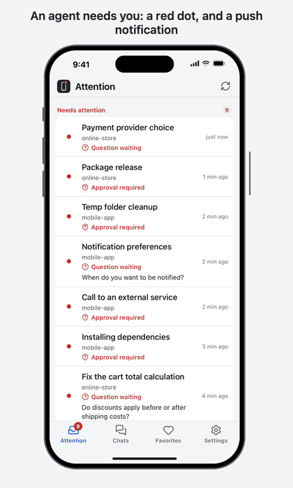
  </picture>
</p>

> Unofficial project, not affiliated with Anysphere. It relies on Cursor internals (a local SQLite database and the Agents Window
> interface) that can change without notice. Tested on Cursor 3.24.x.

## Why

Agents are most useful when you can leave them working. The catch is that they stop and wait: a question to answer, a command to
approve, a plan to read. Cursor shows a red dot for those moments, but only on the Mac.

cursor-pocket sends you a push notification when that happens and lets you handle it from the phone, wherever you are, hours or
days later if you want. Everything stays on your machine and your private network: there is no cloud service and no account.

## What you can do

**Out of the box (read-only)**

- Get a push notification for a new agent question, a command waiting for approval, and a finished chat.
- See your chats grouped by project in the same order as the Agents Window sidebar, with a red dot for "needs attention".
- Ignore a request locally (nothing is sent to Cursor, and a new request brings the dot back), favorite chats, mute a chat or a
  project, set quiet hours, show the number of pending decisions on the app icon.
- Read the whole conversation of a chat, page by page.
- Manage paired devices and revoke them.

**With Cursor started on a local debug port** (`tools/cursor-cdp.sh`)

- Answer questions (single choice, multiple choice, free text) and approve or reject terminal commands.
- Send a message, with images, and stop a running agent.
- Start a new chat on a project, optionally choosing the branch and the model.
- Rename, pin, archive and restore chats.
- Keep the Mac awake while an agent works, optionally with the lid closed.

The actions drive the real Agents Window, so Cursor records them exactly as if you had clicked on the Mac. The daemon refuses to
type into the wrong chat, never overwrites a draft you wrote on the Mac, and cleans up after itself when something fails.

<table>
  <tr>
    <td align="center">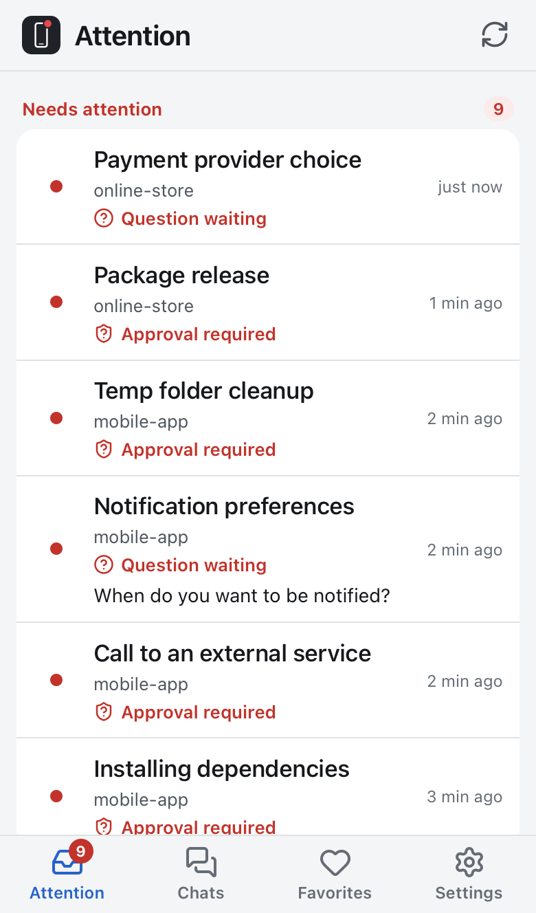<br><sub>Attention</sub></td>
    <td align="center">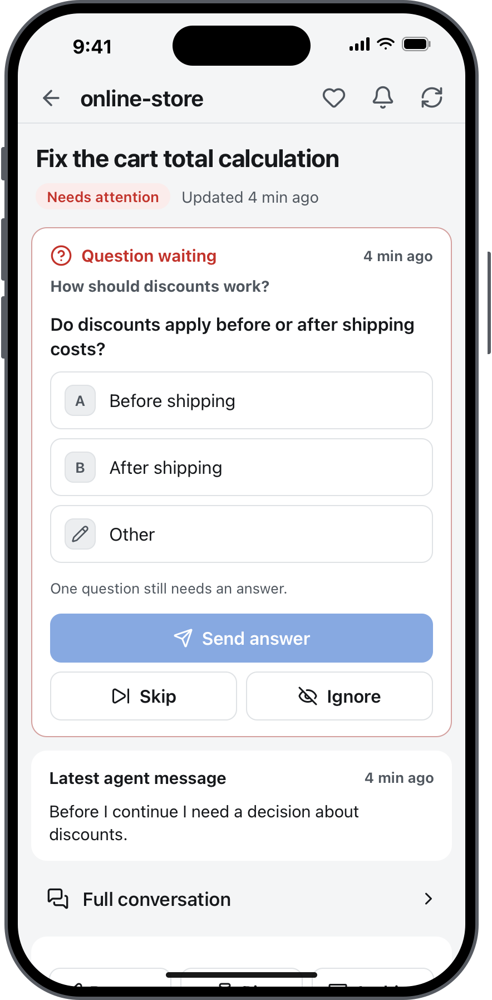<br><sub>Answer a question</sub></td>
    <td align="center">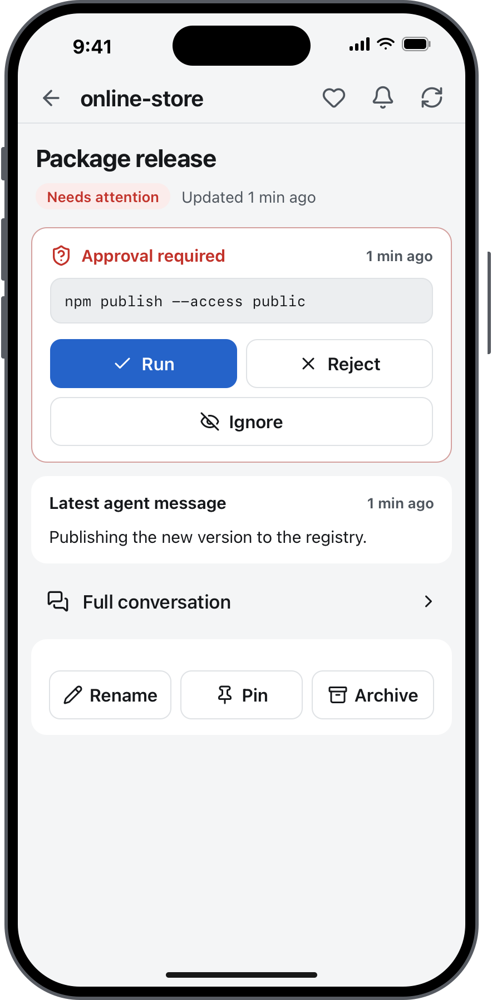<br><sub>Approve a command</sub></td>
    <td align="center">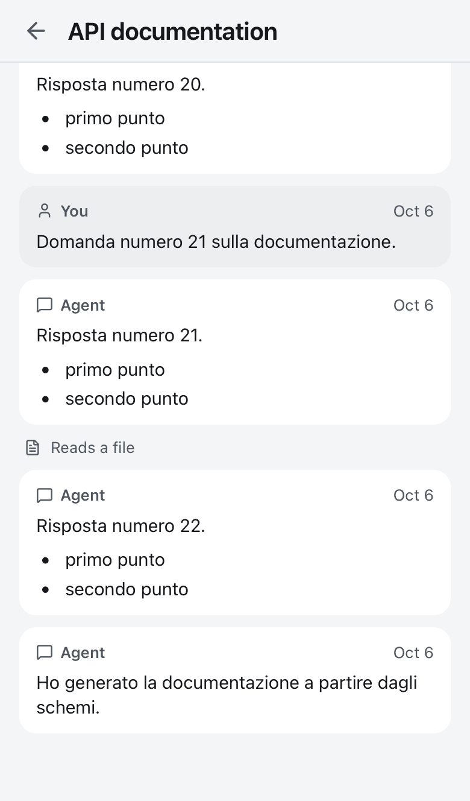<br><sub>Read the conversation</sub></td>
  </tr>
  <tr>
    <td align="center">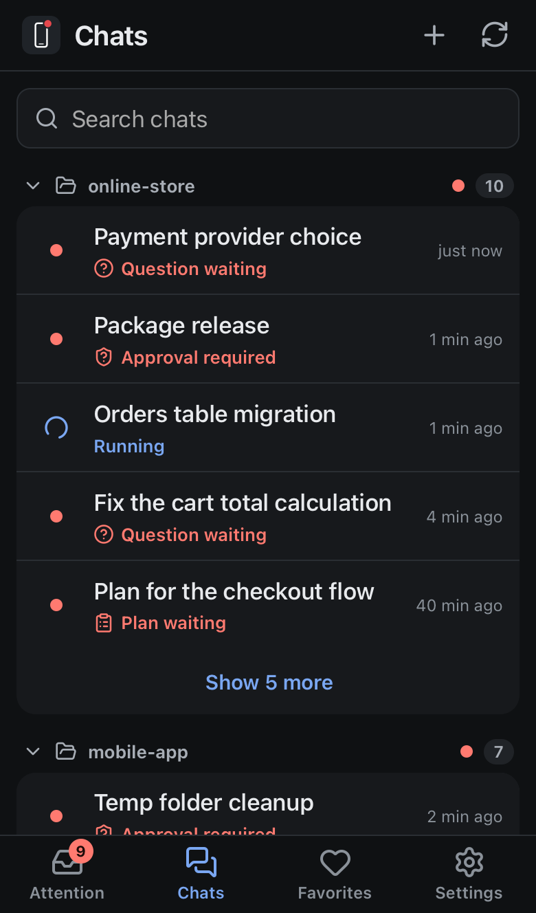<br><sub>Chats by project, dark</sub></td>
    <td align="center">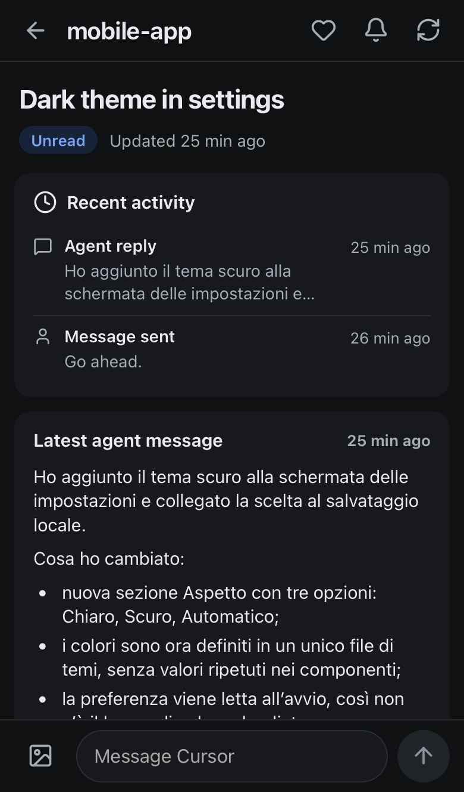<br><sub>A chat, dark</sub></td>
    <td align="center">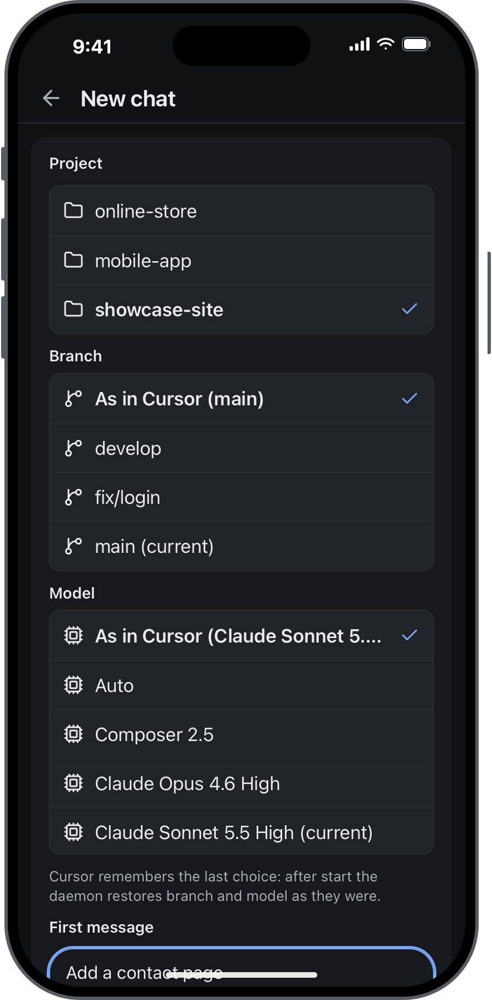<br><sub>New chat</sub></td>
    <td align="center">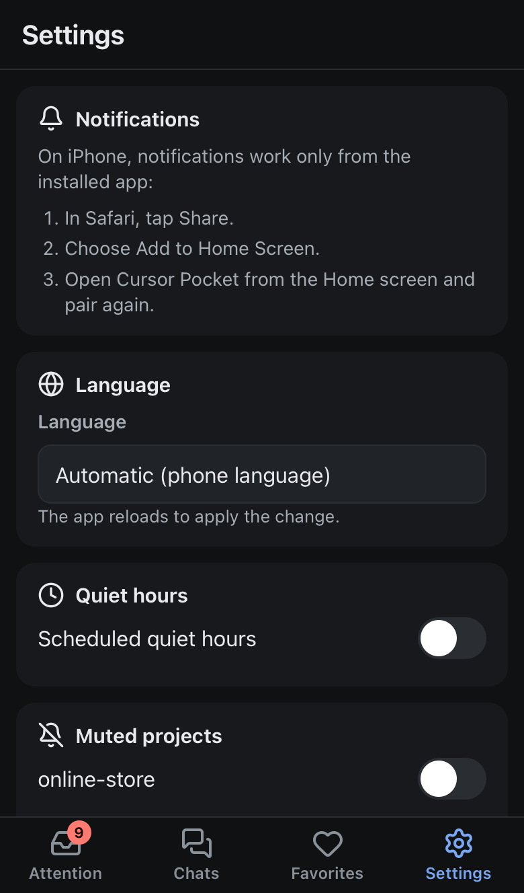<br><sub>Settings</sub></td>
  </tr>
</table>

Screenshots come from the demo server (`npm run demo`, invented data).

## Languages

English, Italian, Spanish, French, German, Portuguese, Japanese and Simplified Chinese. The app follows the phone's language and
you can change it in Settings. Push notifications are written by the daemon in the language of each device.

<p>
  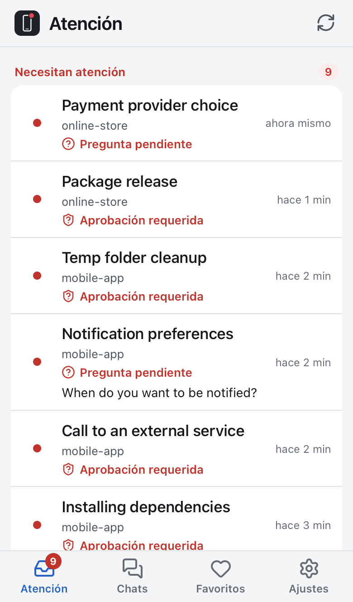
  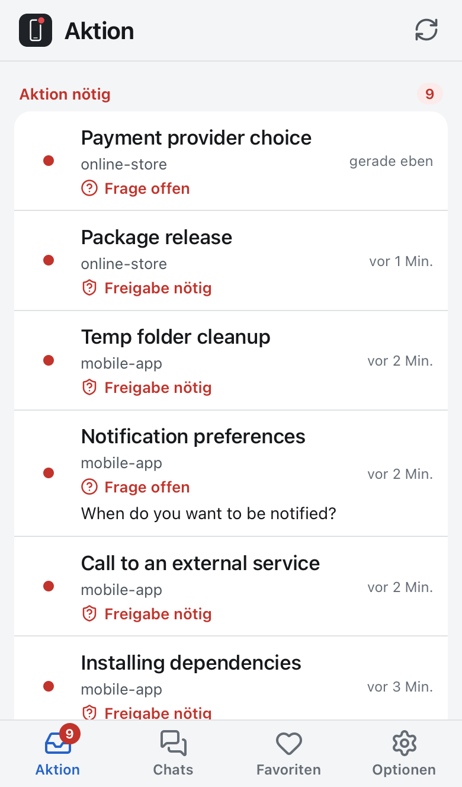
  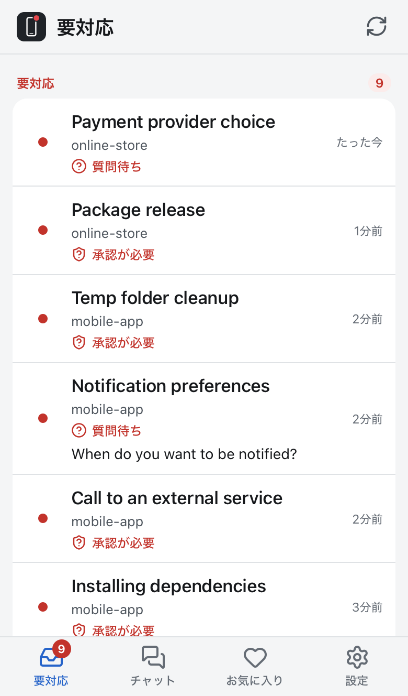
</p>

English and Italian were written by hand. The other six were machine-translated and are waiting for native speakers: fixes to the
wording are very welcome as pull requests. To add a language, copy `pwa/js/i18n/locales/en.js`, translate the values, add the code
to `LANGUAGES` in `pwa/js/i18n/index.js` and `daemon/src/i18n.js`, and add the push messages in `daemon/src/i18n-messages.js`.
`npm test` fails if a catalog misses a key or a placeholder.

## How it works

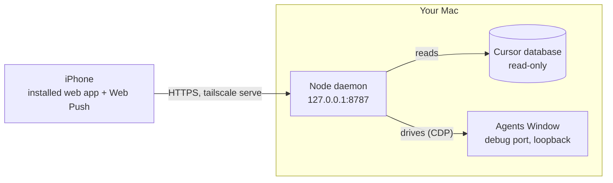

- **Reading** uses Cursor's own SQLite database, always opened read-only and never scanned in full: the daemon asks for one chat at
  a time. It decides what "needs attention" means from the same flags Cursor uses for its red dot.
- **Acting** uses the Chrome DevTools Protocol on a loopback-only debug port, so Cursor itself performs the click or the typing.
  Every action is checked afterwards against the database whenever possible.
- **Notifying** uses standard Web Push (RFC 8291 and 8292, implemented with `node:crypto` only), with deduplication so you are not
  reminded of the same thing twice.
- Everything that depends on Cursor internals lives in `daemon/src/cursor/`, so a Cursor update means touching one place.

Details in [docs/ARCHITECTURE.md](docs/ARCHITECTURE.md). What has been verified, how, and what has not, in
[docs/FINDINGS.md](docs/FINDINGS.md).

## Quick start

Requirements: macOS with Cursor 3.x, Node 22.13 or newer, Tailscale on the Mac and the iPhone, and iOS 16.4 or newer for push
notifications (they only work from the app installed on the Home Screen).

Try it first, without touching your data:

```sh
cd daemon
npm run demo        # fake Cursor with invented chats, open the printed URL
```

Then run it for real (the full guide, including Tailscale and iPhone pairing, is [docs/SETUP.md](docs/SETUP.md)):

```sh
cd daemon
npm start                       # listens on 127.0.0.1:8787 only
npm run pair                    # prints a one-time pairing code
tailscale serve --bg 8787       # HTTPS inside your tailnet (never use Funnel)
tools/launchd.sh install        # optional: start at login
tools/cursor-cdp.sh             # optional: start Cursor with the debug port, to act from the phone
```

On the iPhone, open the HTTPS address in Safari, choose Share, Add to Home Screen, open the app from the Home Screen and enter the
pairing code.

## Security

Answering from the phone means controlling an agent that can run shell commands on your Mac, so the defaults are conservative:

- The daemon listens on localhost only. The intended way in is `tailscale serve`, which keeps it inside your private network.
  **Never use `tailscale funnel`.**
- Each device pairs with a one-time code and gets its own revocable session. Without a session the API answers 401, and requests
  that change data also check their origin.
- The Cursor database is opened read-only. Chats, keys and tokens are never written to logs.
- The debug port, while open, lets any program running as you control Cursor: start it only when you need the actions.

Read [SECURITY.md](SECURITY.md) before exposing anything, and report vulnerabilities privately.

## Status

In daily use on a real iPhone. The actions were verified live against a real Cursor (see FINDINGS, sections 10 and 11). Still to
confirm on a physical iPhone: the newest features, push on a locked screen, and long-term stability: see
[docs/IPHONE-CHECKLIST.md](docs/IPHONE-CHECKLIST.md). Plans and open items are in [docs/ROADMAP.md](docs/ROADMAP.md).

Known limits:

- It depends on Cursor's interface, which can change: after an update, expect to adjust the selectors in
  `daemon/src/cursor/agents-ui.js`.
- Only local chats (not cloud chats, not archived ones, not sub-agents).
- Approving a command from the phone is covered by tests and by the reject path, which shares the same code.

## Development

```sh
cd daemon && npm test           # 268 tests, Node's built-in runner
npm run demo                    # synthetic data and a fake Cursor
node tools/ui-check.mjs webkit  # optional browser checks, about 160 (also chromium, --dark)
node tools/readme-shots.mjs     # regenerates the screenshots above
```

The browser tools need `playwright-core` (set `PLAYWRIGHT_CORE` to its `index.mjs`); the daemon itself needs nothing installed.
Working rules for contributors and AI agents are in [AGENTS.md](AGENTS.md); see also [CONTRIBUTING.md](CONTRIBUTING.md).

## Repository layout

| Path | What is in it |
| --- | --- |
| `daemon/` | the daemon (read-only on Cursor's database) and its tests |
| `pwa/` | the web app: plain HTML, CSS and JavaScript modules, no build |
| `tools/` | demo server, `launchd.sh`, `cursor-cdp.sh`, browser checks, icon, screenshot and demo-animation generators, macOS power helpers |
| `site/` | the static project page (plain HTML and CSS); publish it from a `gh-pages` branch or GitHub Pages when the repo is public |
| `docs/` | setup, architecture, findings, roadmap, iPhone checklist |
| `research/` | research scripts and prototypes, not used in production |

## License

MIT, see [LICENSE](LICENSE). Icons come from [Lucide](https://lucide.dev) (ISC, `pwa/icons/LICENSE-lucide.txt`). "Cursor" is a trademark of Anysphere; this project
is not affiliated with it and does not use its logo.
