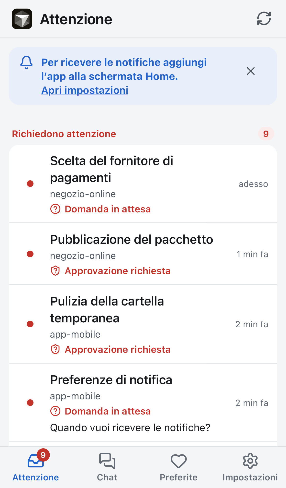
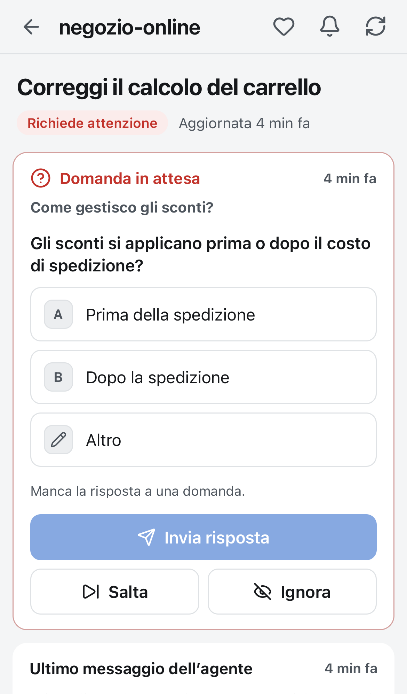
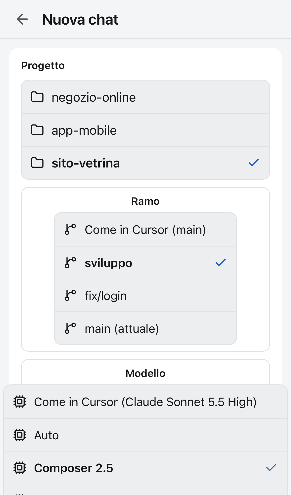
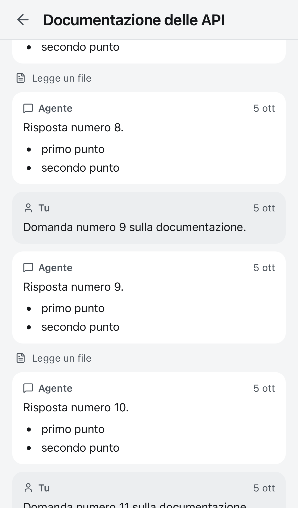

# cursor-pocket

Controlla da iPhone le chat locali dell'Agents Window di Cursor (PWA + daemon Node 22 senza dipendenze, solo su macOS).

**English summary.** cursor-pocket is a small daemon plus an installable web app (PWA) that lets you follow and drive the
*local* chats of Cursor 3.x's Agents Window from an iPhone: push notifications for questions, command approvals and finished
chats; reply to questions, send messages (with images), stop an agent, start new chats, rename/pin/archive chats; keep the Mac
awake while an agent works. It reads Cursor's local SQLite database read-only and acts on the UI through the Chrome DevTools
Protocol (Cursor started with a local debug port). It is exposed only through `tailscale serve` (never Funnel) with mandatory
pairing. Unofficial, depends on Cursor internals that may change. The documentation is written in Italian.

Funzioni: notifiche push (domanda, approvazione "allow", chat finita), elenco raggruppato per progetto come nella sidebar,
"Ignora" (solo nell'app), preferite, silenzia chat/progetti e orari, conversazione intera in sola lettura, dispositivi abbinati.
Con Cursor avviato con una porta di debug locale: rispondere alle domande, approvare o rifiutare comandi, scrivere messaggi (anche con
immagini), fermare l'agente, avviare una chat nuova su un progetto, rinominare, fissare e archiviare/ripristinare chat. Opzionale:
Mac sveglio mentre un agente lavora (anche a schermo chiuso con una regola sudo limitata, `tools/mac/power-setup.sh`).

Stato: in uso su un iPhone reale con avvio automatico (`tools/launchd.sh install`). Le azioni su Cursor sono state provate dal vivo su
un Cursor vero (FINDINGS 10.x e 11.x); "Esegui" su un comando vero e' coperto solo da test e dal rifiuto, che usa lo stesso percorso.
Test: `cd daemon && npm test` (254 test) e, facoltativi, 141-143 controlli nel browser (`tools/ui-check.mjs`, WebKit e Chromium).
Ancora da verificare su iPhone vero: le novita' dopo la Fase 2 (barra, stop, nuova chat, allegati, rinomina/archivia/fissa), push a
schermo bloccato, tocco sulla notifica, badge, tenuta nei giorni. Vedi `docs/ROADMAP.md`.

<p>




</p>

Le schermate sono del server dimostrativo (`npm run demo`, dati inventati).

Prova rapida senza toccare i dati reali (nessuna installazione necessaria, serve Node >= 22.13):
```
cd daemon
npm run demo
```

- `docs/SETUP.md`        installazione, Tailscale, iPhone, variabili di configurazione
- `docs/FINDINGS.md`     cosa e' stato verificato (e cosa no)
- `docs/ARCHITECTURE.md` architettura e regole di derivazione
- `docs/ROADMAP.md`      fasi
- `docs/IPHONE-CHECKLIST.md` prove da fare su un iPhone vero
- `SECURITY.md`          modello di minaccia e segnalazione di problemi
- `daemon/`              daemon (sola lettura sul database di Cursor), test con `npm test`
- `pwa/`                 app web (HTML/CSS/JS senza build)
- `tools/`               generatori di icone, server dimostrativo, `launchd.sh` (avvio automatico), `cursor-cdp.sh`
                         (Cursor con porta di debug), `ui-check.mjs` (verifica facoltativa nel browser)
- `research/`            script di ricerca e prototipi

Avvertenza: rispondere dal telefono (Fase 2) equivale a controllare un agente con accesso alla shell del Mac, e richiede
una porta di debug di Cursor che, finche' e' aperta, permette a qualunque programma locale di controllarlo. Attivala solo
se ti serve, usa il servizio solo dietro Tailscale e con autenticazione. Il logo di Cursor nell'app e' un marchio di
Anysphere, tenuto in un file sostituibile (vedi `docs/SETUP.md`, "Marchio Cursor").

## Licenza e avvertenze

Codice con licenza MIT (vedi `LICENSE`); le icone derivano da Lucide (licenza ISC, `pwa/icons/LICENSE-lucide.txt`).
Progetto non ufficiale e non affiliato a Anysphere: "Cursor" e il suo marchio appartengono ai rispettivi proprietari.
Dipende da dettagli interni di Cursor (database locale e interfaccia dell'Agents Window) che possono cambiare senza preavviso.
